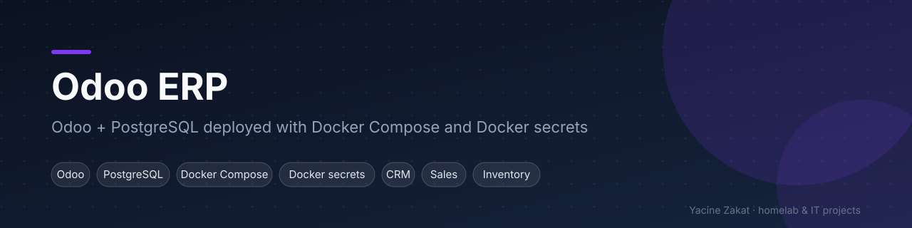
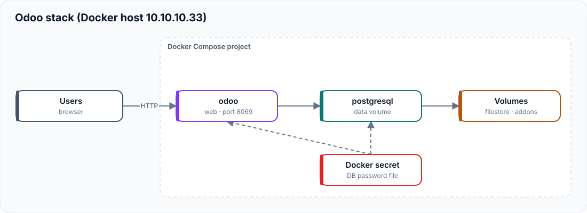

<p align="center"></p>

# Odoo ERP Homelab

Odoo and PostgreSQL deployed with Docker Compose, with the database password delivered through a **Docker secret** instead of an environment variable.

| | |
|---|---|
| **Status** | Lab project (not currently running) |
| **Stack** | Odoo · PostgreSQL · Docker Compose · Docker secrets · Linux |
| **Related** | [Docker & Portainer](https://github.com/bugHunte3R/Docker-Portainer) · [Proxmox homelab](https://github.com/bugHunte3R/Proxmox) |

## Architecture

<p align="center"></p>

## Quick start

```bash
# 1. Put the database password in a local file that is never committed
printf '%s' 'choose-a-strong-password' > odoo_pg_pass
chmod 600 odoo_pg_pass

# 2. Start the stack
docker compose up -d
docker compose ps

# 3. Open http://<docker-host>:8069 and create the first database
```

The real [`docker-compose.yaml`](docker-compose.yaml) mounts `odoo_pg_pass` as the `postgresql_password` secret for both containers (`PASSWORD_FILE` / `POSTGRES_PASSWORD_FILE`).

## What I practised

- Business apps: CRM, Sales, Purchase, Inventory, Accounting — [docs/modules.md](docs/modules.md)
- Users, groups and access rights — [docs/users-permissions.md](docs/users-permissions.md)
- PostgreSQL administration and backups (`pg_dump` + filestore) — [docs/postgresql.md](docs/postgresql.md) · [docs/backup.md](docs/backup.md)
- Upgrades and troubleshooting — [docs/deployment.md](docs/deployment.md) · [docs/troubleshooting.md](docs/troubleshooting.md)
- Secret handling: the password file is ignored by Git; an older committed value was purged from the Git history

## Fictional addressing used in this repository

| Role | Address |
|---|---|
| Docker host running Odoo | `10.10.10.33` |
| Homelab network | `10.10.10.0/24` |

## Skills demonstrated

ERP deployment · Docker Compose · Docker secrets · PostgreSQL · backups · access control · incident response for leaked secrets

---
**Yacine Zakat** — IT Support & Application Support Technician
